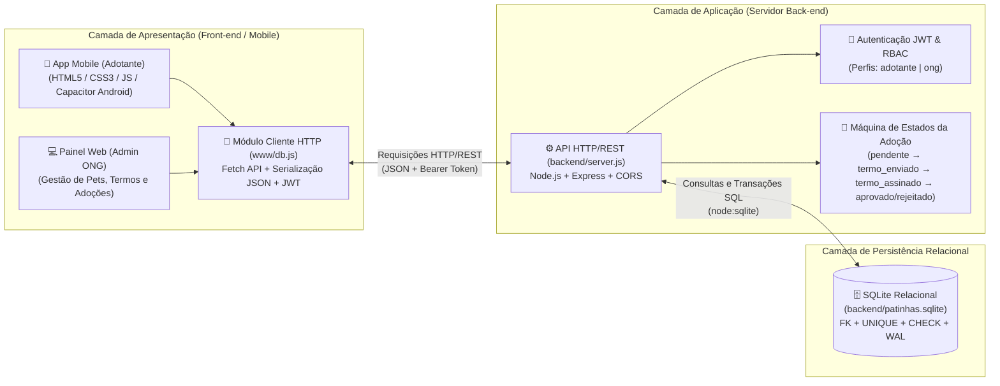

# 🐾 Patinhas — Plataforma Distribuída para Adoção Responsável de Animais

**Instituto Federal de Educação, Ciência e Tecnologia do Rio Grande do Norte (IFRN) — Campus Natal Zona Leste**  
**Discente:** Lucas Aprígio da Silva (`20232158060024`)

---

## 📦 Entregas da Etapa 3 (Arquitetura Distribuída, API REST, Banco Relacional e OpenAPI)

| Item de Entrega | Arquivos / Links Diretos |
| :--- | :--- |
| **1. Código-fonte Integrado** | Servidor API REST ([`backend/server.js`](backend/server.js)), Camada de Persistência Relacional SQLite ([`backend/database.js`](backend/database.js), [`backend/schema.sql`](backend/schema.sql), [`backend/patinhas.sqlite`](backend/patinhas.sqlite)), Módulo Cliente HTTP ([`www/db.js`](www/db.js)) e Interfaces Mobile/Web ([`www/`](www/)). |
| **2. Diagrama e Justificativas** | 📄 [**`docs/Entrega_Etapa3_Arquitetura_API_REST_Patinhas.pdf`**](docs/Entrega_Etapa3_Arquitetura_API_REST_Patinhas.pdf) *(também resumido abaixo neste README)*. |
| **3. Documentação da API (OpenAPI 3.0 / Swagger)** | 🌐 [**Swagger UI Interativo (GitHub Pages)**](https://lucasaprigiodev.github.io/projeto-integrador-patinhas/swagger.html) • 📄 [**`backend/openapi.json`**](backend/openapi.json) • 📄 [**`swagger.html`**](swagger.html) • Rota local: `http://localhost:3000/api-docs`. |
| **4. Relatório Final (PDF)** | 📄 [**`docs/Relatorio_Final_Projeto_Integrador_Patinhas.pdf`**](docs/Relatorio_Final_Projeto_Integrador_Patinhas.pdf) |

---

## 🏗️ 1. Diagrama da Arquitetura Distribuída



---

## 🗄️ 2. Modelagem Relacional e Justificativa do Banco de Dados

O esquema relacional ([`backend/schema.sql`](backend/schema.sql)) é composto por **4 tabelas integradas por chaves estrangeiras (`PRAGMA foreign_keys = ON`)**:

1. **`usuarios`**: Armazena adotantes e ONGs (`id` PK, `nome`, `cpf` UNIQUE, `telefone`, `email` UNIQUE, `senha_hash` com derivação `scrypt`, `perfil` CHECK `'adotante' | 'ong'`, `avatar_url`).
2. **`animais`**: Catálogo de pets vinculados à ONG responsável (`id` PK, `nome`, `especie`, `raca`, `idade`, `porte`, `sexo`, `distancia`, `descricao`, `foto_url`, `status` CHECK `'disponivel' | 'em_processo' | 'adotado'`, `ong_id` FK → `usuarios.id`).
3. **`adocoes_matches`**: Registra os processos de adoção e a máquina de estados (`id` PK, `animal_id` FK → `animais.id`, `adotante_id` FK → `usuarios.id`, `status`, `termo_enviado`, `termo_assinado`, `assinatura_digital`, restrição `UNIQUE(animal_id, adotante_id)`).
4. **`mensagens`**: Histórico do chat de adoção e envio do Termo de Adoção (`id` PK, `match_id` FK → `adocoes_matches.id`, `remetente_id` FK → `usuarios.id`, `remetente_perfil`, `texto`, `is_termo`, `horario`).

### Justificativa da Escolha do SQLite Relacional (`node:sqlite`)
- **Integridade Relacional e Transações ACID:** Garante cumprimento estrito de chaves estrangeiras (`ON DELETE CASCADE` / `RESTRICT`), unicidade (`UNIQUE`) e validação de domínio (`CHECK`) diretamente no motor SQL.
- **Persistência Durável Pós-Reinicialização:** Os dados ficam gravados no arquivo binário [`backend/patinhas.sqlite`](backend/patinhas.sqlite) com modo *Write-Ahead Logging* (`WAL`), preservando todos os cadastros, matches, assinaturas e mensagens mesmo após reiniciar o servidor.
- **Execução Imediata com Seeds Iniciais:** O módulo [`backend/database.js`](backend/database.js) cria as tabelas e popula dados fictícios iniciais automaticamente, permitindo avaliação imediata sem necessidade de configurar SGBDs externos.

---

## 🌐 3. Justificativa da Arquitetura REST em Comparação ao SOAP

A escolha da arquitetura **REST (Representational State Transfer)** sobre HTTP com payloads **JSON** em vez do protocolo **SOAP (Simple Object Access Protocol)** justifica-se por:

1. **Leveza de Payload para Dispositivos Móveis:** O formato JSON possui baixa verbosidade comparado aos envelopes XML exigidos pelo SOAP (`<soap:Envelope>`, `<soap:Body>`), reduzindo o tráfego de rede e o tempo de resposta no aplicativo Android e no navegador.
2. **Semântica Nativa do Protocolo HTTP:** A API utiliza diretamente os verbos HTTP (`GET`, `POST`, `PUT`, `PATCH`, `DELETE`) e códigos de status semânticos (`200 OK`, `201 Created`, `400 Bad Request`, `401 Unauthorized`, `403 Forbidden`, `404 Not Found`, `409 Conflict`, `422 Unprocessable Entity`), enquanto o SOAP encapsula operações em chamadas `POST` genéricas.
3. **Integração Direta com as Interfaces (`www/db.js`):** O consumo REST via `fetch()` e serialização nativa `JSON.stringify()` / `JSON.parse()` elimina a necessidade de parsers WSDL/XML complexos no cliente.
4. **Arquitetura Stateless com JWT:** Cada requisição porta seu próprio token JWT no cabeçalho `Authorization: Bearer <token>`, desacoplando o servidor das interfaces.

---

## 🚀 4. Como Executar o Servidor e Testar

```bash
# 1. Instalar dependências (caso necessário)
npm install

# 2. Iniciar o servidor API HTTP/REST + Banco Relacional SQLite
node backend/server.js
```

Com o servidor ativo na porta `3000`, acesse:
- **Aplicativo / Painel Integrado:** `http://localhost:3000/01-login.html`
  - **Conta Admin ONG (Seed):** `admin@ong.com` / senha: `admin`
  - **Conta Adotante (Seed):** `lucas@ifrn.edu.br` / senha: `123456`
- **Documentação Interativa OpenAPI (Swagger UI):** `http://localhost:3000/api-docs`
- **Especificação OpenAPI 3.0 (JSON):** `http://localhost:3000/api/openapi.json`

